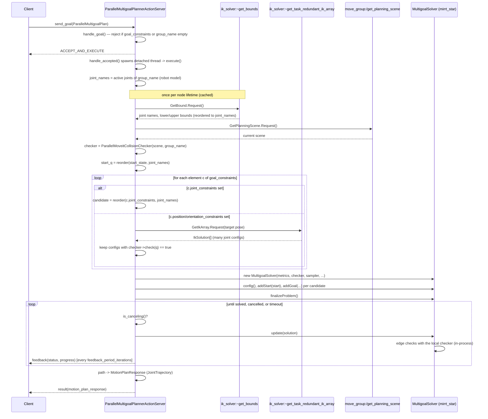

# 4. Architecture

## Sequence, end to end



## Class responsibilities

| Class | File | Responsibility |
|---|---|---|
| `ParallelMultigoalPlannerActionServer` | `parallel_multigoal_planner_action_server.{hpp,cpp}` | Owns the action server, the robot model and the three service clients; for each goal fetches the planning scene, creates the collision checker, runs `execute()` and converts `Path` → `MotionPlanResponse`. |
| `GoalSetBuilder` | `goal_set_builder.{hpp,cpp}` | Turns `goal_constraints[]` into a flat `std::vector<Eigen::VectorXd>` of candidate joint-space goals. Owns the `~get_bounds` / `~get_task_redundant_ik_array` request/response plumbing, and filters IK solutions with the collision checker it is given. |
| `graph::collision_check::ParallelMoveitCollisionChecker` | `moveit_collision_checker` package | In-process collision checker on a local copy of the planning scene. One instance per goal, shared by `GoalSetBuilder` (IK filtering) and `MultigoalSolver` (tree extension). |
| `reorderByJointName()` | `joint_order_utils.hpp` | The one place that maps a `(names, values)` pair (from a `JointState`, a `JointConstraint[]`, or an IK response) onto the canonical joint order. Every `Eigen::VectorXd` in the planner goes through this. |

## Collision checking

All collision checks run in-process, on a `planning_scene::PlanningScene`
built from `/get_planning_scene` when the request starts. The same checker is
used to filter IK solutions (once per Cartesian goal element) and by
`MultigoalSolver` while it extends its trees (the hot path: thousands of
calls per goal). `checkConnection()` checks points `checker_resolution`
apart along each edge, split across `checker_threads` threads.

Each request gets its own scene and checker, so concurrent requests do not
share collision state, and a request does not see scene changes made while it
is planning.

## Why drive `update()` manually instead of calling `solve()`?

`graph_core::TreeSolver::solve()` is a tight loop with no hooks:

```cpp
for (unsigned int iter = 0; iter < max_iter; iter++) {
  if (update(solution)) { solved_ = true; return true; }
  if (elapsed >= 0.98 * max_time) break;
}
return false;
```

Calling it directly would give no way to check `gh->is_canceling()` or call
`gh->publish_feedback()` mid-solve. `execute()` reimplements the same
stopping criterion (stop at the first improving `update()`, or at time/
iteration limits) itself, adding the cancellation check and periodic
feedback publish — see `parallel_multigoal_planner_action_server.cpp`.

One subtlety this handles explicitly: `MultigoalSolver::addGoal()` can
already find a direct start→goal connection (and set `solved_ = true`)
*before* the `update()` loop ever runs — in that case `solver->getSolution()`
is used to retrieve the path, since the loop body (which is what would
otherwise assign the local `solution` variable) never executes.

## Threading

See the README's [Concurrency model](../README.md#concurrency-model) section
for the callback-group/executor layout. In short: one detached
`std::thread` per accepted goal, each with its own `MultigoalSolver`
instance; three shared, stateless service-client wrappers; a
`MultiThreadedExecutor` spinning the node so blocking `future.wait_for()`
calls inside a goal's thread never stall other goals or the action server's
own goal/cancel callbacks.

Next: [5. Tuning and parameters](05-tuning-and-parameters.md).
